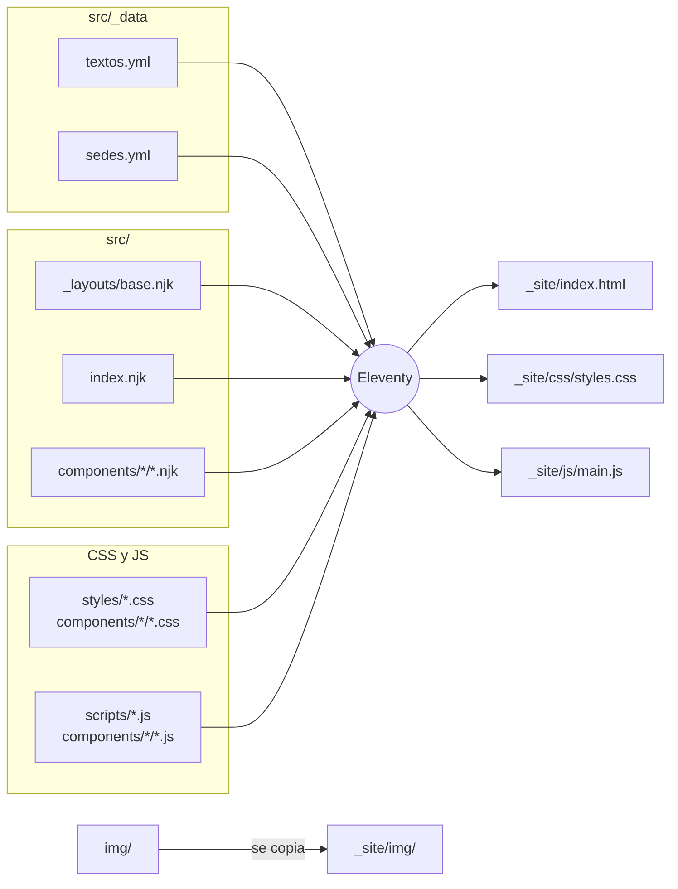
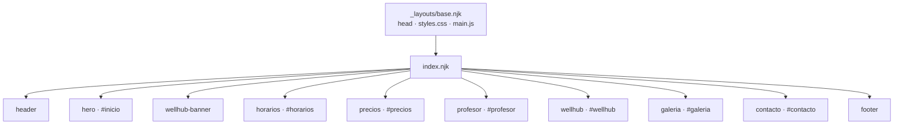

<p align="center">
  
</p>

<h1 align="center">Templo Jiu Jitsu Culture Chile</h1>

<p align="center">
  Landing de la academia de Jiu Jitsu Brasileño y MMA en Ñuñoa y Escuela Militar.<br>
  <a href="https://mgbriones.github.io/templo_chile/#inicio"><strong>mgbriones.github.io/templo_chile</strong></a>
</p>

---

## Contenido

- [Qué es](#qué-es)
- [Cómo funciona](#cómo-funciona)
- [Estructura de archivos](#estructura-de-archivos)
- [Cómo se compone la página](#cómo-se-compone-la-página)
- [Componentes](#componentes)
- [Desarrollo local](#desarrollo-local)
- [Tareas comunes](#tareas-comunes)
- [Publicación](#publicación)

## Qué es

Una página única con la información de la academia:

- **Horarios** semanales de cada sede, con enlace a Google Maps.
- **Precios** de los planes de la sede Ñuñoa y la clase de prueba gratis.
- **Profesor**: Felipe Santibañez y sus logros.
- **Convenio con Wellhub**.
- **Galería** de fotos por sede.
- **Contacto** por Instagram y botón para compartir por WhatsApp.

Es un sitio **estático**: no tiene servidor ni base de datos. Se arma con [Eleventy](https://www.11ty.dev/) a partir de plantillas y archivos YAML, y el resultado son archivos HTML, CSS, JS e imágenes que GitHub Pages sirve tal cual.

## Cómo funciona

El contenido (textos y datos) está separado de la vista (plantillas, estilos y scripts). Eleventy junta todo al construir:



- **HTML**: las plantillas `.njk` (Nunjucks) son HTML con variables como `{{ textos.hero.titulo }}`, que Eleventy reemplaza por los textos del YAML.
- **CSS**: los estilos globales y los de cada componente se juntan en un solo `css/styles.css` ([src/assets/styles.11ty.js](src/assets/styles.11ty.js)).
- **JS**: los scripts globales y los de cada componente se juntan en un solo `js/main.js` ([src/assets/main.11ty.js](src/assets/main.11ty.js)).

## Estructura de archivos

```
templo_chile/
├── src/                          # Fuente del sitio (lo que se edita)
│   ├── index.njk                 # Página: lista los componentes en orden
│   ├── _layouts/
│   │   └── base.njk              # Esqueleto HTML: <head>, fuentes, carga de CSS y JS
│   ├── _data/
│   │   ├── textos.yml            # Todos los textos, agrupados por componente
│   │   └── sedes.yml             # Horarios y fotos de cada sede
│   ├── components/               # Un componente = una carpeta
│   │   ├── header/               # header.njk · header.css
│   │   ├── hero/                 # hero.njk · hero.css
│   │   ├── wellhub-banner/       # wellhub-banner.njk · wellhub-banner.css
│   │   ├── horarios/             # horarios.njk · horarios.css
│   │   ├── precios/              # precios.njk · precios.css
│   │   ├── profesor/             # profesor.njk · profesor.css
│   │   ├── wellhub/              # wellhub.njk · wellhub.css · iconos/*.svg
│   │   ├── galeria/              # galeria.njk · galeria.css · galeria.js
│   │   ├── contacto/             # contacto.njk · contacto.css · contacto.js
│   │   └── footer/               # footer.njk · footer.css
│   ├── styles/
│   │   ├── tokens.css            # Variables: colores, fuentes, ancho máximo
│   │   └── base.css              # Estilos compartidos: secciones, títulos, botones, pestañas
│   ├── scripts/
│   │   └── pestanas.js           # Pestañas de sede (usadas por horarios y galería)
│   ├── assets/                   # Generan css/styles.css y js/main.js
│   └── _lib/
│       └── juntar.js             # Junta los archivos CSS/JS de todos los componentes
├── img/                          # Fotos y logo usados en la página
├── docs/                         # Imágenes del README (no se publican)
├── eleventy.config.js            # Configuración de Eleventy (carpetas, YAML, imágenes)
├── package.json                  # Dependencias y comandos (dev, build)
├── .github/workflows/deploy.yml  # Construye y publica en GitHub Pages
└── _site/                        # Resultado del build (generado, no se versiona)
```

## Cómo se compone la página

`base.njk` es el marco. Dentro va `index.njk`, que incluye los componentes en el orden en que aparecen en pantalla:



Cada componente sigue la misma regla:

```
components/<nombre>/
├── <nombre>.njk   # HTML del componente (empieza con un comentario que lo documenta)
├── <nombre>.css   # Estilos propios (clases <nombre>__elemento)
└── <nombre>.js    # Solo si tiene comportamiento propio
```

Lo que comparten varios componentes no se repite: va en `styles/base.css` (botones, títulos, pestañas) o en `scripts/pestanas.js`.

## Componentes

| Componente | Qué muestra | Textos y datos | JS |
|---|---|---|---|
| `header` | Logo, nombre y menú fijo arriba | `textos.yml > header` | — |
| `hero` | Portada con lema y botones | `textos.yml > hero` | — |
| `wellhub-banner` | Franja que anuncia el convenio | `textos.yml > wellhub_banner` | — |
| `horarios` | Pestañas por sede, mapa y grilla semanal | `sedes.yml` · `textos.yml > horarios` | `scripts/pestanas.js` |
| `precios` | Tarjetas de planes y notas | `textos.yml > precios` | — |
| `profesor` | Foto, logros y biografía | `textos.yml > profesor` | — |
| `wellhub` | Detalle del convenio y beneficios | `textos.yml > wellhub` | — |
| `galeria` | Carrusel de fotos por sede | `sedes.yml > fotos` · `textos.yml > galeria` | `galeria.js` · `scripts/pestanas.js` |
| `contacto` | Llamado a escribir y compartir | `textos.yml > contacto` | `contacto.js` |
| `footer` | Datos de contacto y créditos | `textos.yml > footer` | — |

Los enlaces que se repiten (Instagram, Wellhub) están una sola vez en `textos.yml > enlaces`.

## Desarrollo local

Requiere Node 22 o superior.

```bash
npm install
npm run dev     # http://localhost:8080, se recarga al guardar
npm run build   # genera _site/ (se puede abrir _site/index.html sin servidor)
```

## Tareas comunes

| Quiero… | Dónde |
|---|---|
| Cambiar un texto, precio o botón | `src/_data/textos.yml`, bajo la clave del componente |
| Agregar o mover una clase en el horario | `src/_data/sedes.yml` → `horario` de la sede: `clases: { lun: bjj, mie: mma }` |
| Crear un tipo de clase nuevo | `src/_data/textos.yml > horarios.clases` (+ su color en `horarios.css` si es un estilo nuevo) |
| Agregar una foto a la galería | Subir la foto a `img/` y agregarla en `sedes.yml` → `fotos` de la sede |
| Agregar un plan de precios | `textos.yml > precios.planes` (variante `destacado`, `normal` o `prueba`) |
| Cambiar un color o fuente | `src/styles/tokens.css` |
| Cambiar el orden de las secciones | `src/index.njk` |
| Crear una sección nueva | Nueva carpeta en `src/components/`, incluirla en `index.njk` y sus textos en `textos.yml` |
| Cambiar título, descripción o vista previa para redes | `textos.yml > sitio` |

## Publicación

Cada push a `main` ejecuta [.github/workflows/deploy.yml](.github/workflows/deploy.yml): instala dependencias, corre `npm run build` y publica `_site/` en GitHub Pages. Si el build falla, no se publica nada y sigue en línea la versión anterior.

> En **Settings → Pages → Source** del repositorio debe estar seleccionado **GitHub Actions**.
